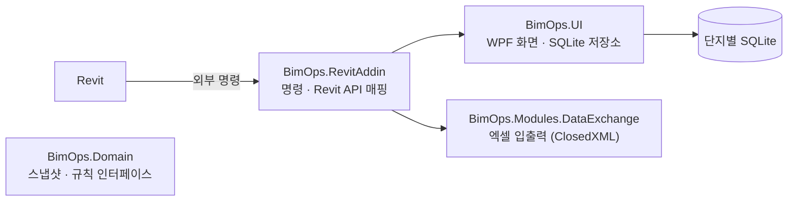

# BimOps — 세대 옵션 물량 자동화 (Revit 애드인)

아파트 단지에서 세대마다 고른 옵션(확장, 붙박이장 등)에 따라 바뀌는 마감재 물량을 Revit 안에서 산출·관리하기 위한 애드인입니다.

**백승규([decembaek](https://github.com/decembaek)) · 개인 프로젝트 · 단독 설계·개발**

현재 화면 흐름과 데이터 모델을 먼저 만든 프로토타입 단계입니다. 단지 목록 DB와 Revit 문(Door) 데이터 엑셀 입출력 모듈은 구현되어 있고, 물량 산출 엔진과 일부 화면은 샘플 데이터로 흐름만 구현되어 있습니다(아래 [구현 상태](#구현-상태) 참고).

## 개발 배경

분양 아파트는 같은 평형이라도 세대마다 선택한 옵션이 달라, 마감재 물량을 세대별로 다시 계산해야 합니다.
이 작업은 보통 엑셀로 평형별 기본 물량에 옵션별 증감을 더하는 방식으로 이뤄지고, 옵션 선택이 바뀔 때마다(차수) 다시 계산하고 비교해야 합니다.
이 반복 작업을 Revit 모델과 연결된 도구로 옮기기 위해 시작했습니다.

## 물량 산출 방식

세대별 최종 물량은 평형 기본 물량에 선택한 옵션들의 증감 물량을 더한 값입니다.

```text
최종 물량(동·호, 마감재) = 기본 물량(평형, 마감재) + Σ 옵션 증감(옵션, 설치 위치, 평형, 마감재)
```

이 계산을 위해 단지 DB를 다음처럼 설계했습니다.

| 테이블 | 내용 |
| --- | --- |
| `unit_type`, `finish_category` | 평형과 마감재 분류(단위 포함) |
| `base_quantity` | 평형별·마감재별 기본 물량 |
| `option_item`, `option_lookup` | 옵션 목록과, 옵션·설치 위치·평형·마감재 조합별 증감 물량 |
| `revision` | 옵션 선택 차수(DRAFT / FROZEN) |
| `unit_option_selection` | 차수별 동·호의 옵션 선택 현황 |
| `quantity_result` | 차수별 동·호·마감재의 기본·증감·최종 물량 |

- 단지 하나를 SQLite 파일 하나로 관리(`%LOCALAPPDATA%/BimOps/Projects/<단지코드>.db`)하고, 단지 목록은 별도 DB(`_projects.db`)에 둡니다.
- 차수를 FROZEN으로 확정하면 이후 차수와 결과를 비교할 수 있도록 결과를 차수에 묶어 저장합니다.
- 조합 조회가 잦은 `option_lookup`에는 (옵션, 설치 위치, 평형, 마감재) 복합 인덱스를 두었습니다.

## 구조



| 프로젝트 | 역할 |
| --- | --- |
| `BimOps.RevitAddin` | Revit 외부 명령, Revit 요소 수집·매핑·갱신 |
| `BimOps.UI` | WPF 화면, 단지 DB 생성, Dapper 기반 저장소 |
| `BimOps.Modules.DataExchange` | Revit API에 의존하지 않는 엑셀 입출력 |
| `BimOps.Domain` | 모델 스냅샷과 검사 규칙 인터페이스 |
| `BimOps.UI.Test` | Revit 없이 화면을 띄워 보는 테스트 앱 |

Revit API 의존 코드를 `RevitAddin`에만 두고, 엑셀 처리와 화면을 별도 프로젝트로 분리해 Revit 없이도 개발·확인할 수 있게 했습니다.

## 화면 흐름

1. **단지 선택**: 단지 카드 목록(최근 수정 순), 첫 실행 시 단지 목록 DB 자동 생성
2. **프로젝트 홈**: 단지 요약과 차수 타임라인
3. **기준 데이터**: 평형·마감재·기본 물량·옵션 증감표 관리
4. **세대 옵션 현황**: 동·호 × 옵션 매트릭스(옵션 열을 데이터에 맞춰 동적 생성)
5. **물량 산출**: 입력 검증 단계를 거친 뒤 산출 실행
6. **산출 결과**: 동·호·마감재별 기본·증감·최종 물량
7. **이력 리포트**: 차수 간 물량 변경 비교

Revit 명령은 화면을 모달리스로 띄워 Revit 작업과 병행할 수 있습니다.

## Revit 문(Door) 데이터 엑셀 연동

모델의 문 요소를 엑셀로 내보내고, 엑셀에서 고친 마크·코멘트를 다시 모델에 반영하는 모듈입니다. 초기 버전에서는 별도 Revit 명령으로 실행했고, 지금은 물량 자동화 화면으로 통합하기 위해 명령 등록을 꺼 둔 상태입니다.

- 내보내기: UniqueId·ElementId·레벨·패밀리·타입·마크·코멘트·폭·높이를 표(Table)로 저장, 머리행 고정
- 가져오기: UniqueId로 요소를 찾아 마크·코멘트를 한 트랜잭션에서 갱신
- 검증: 빈 UniqueId, 엑셀 안의 중복 UniqueId는 건너뛰고 행 번호와 사유를 결과에 기록

## 구현 상태

| 항목 | 상태 |
| --- | --- |
| 단지 DB 스키마, 단지 목록 저장소(CRUD) | 구현 |
| 마감재 분류 저장소(CRUD, 일괄 교체) | 구현 |
| 문 데이터 엑셀 내보내기·가져오기, Revit 반영 | 모듈 구현 (현재 실행 명령에는 미연결) |
| 전체 화면 흐름과 화면 전환 | 구현 |
| 기준 데이터·옵션 현황·산출 결과·이력 화면의 데이터 | 샘플 데이터 |
| 물량 산출 엔진, 입력 검증, 차수 간 비교 | 미구현 (설계 완료) |
| Revit 모델에서 평형별 마감재 물량 추출 | 미구현 |

## 기술 구성

- C# / .NET 10 (`net10.0-windows`), WPF, MaterialDesignThemes
- Revit API 2027 (`RevitAPI.dll`, `RevitAPIUI.dll`)
- SQLite (`Microsoft.Data.Sqlite`) + Dapper
- ClosedXML (엑셀 입출력)

## 빌드와 설치

Windows와 Revit 2027이 필요합니다. `BimOps.RevitAddin.csproj`는 Revit API를 `C:\Program Files\Autodesk\Revit 2027\`에서 참조합니다.

1. `BimOps.slnx`를 Visual Studio로 열어 빌드합니다.
2. 빌드 결과를 `C:\RevitAddins\BimOps\`에 복사합니다.
3. `BimOps.addin`을 Revit 애드인 폴더(`%APPDATA%\Autodesk\Revit\Addins\2027\`)에 복사합니다.
4. Revit을 실행하고 외부 도구에서 **BimOps 실행**을 누릅니다.

Revit 없이 화면만 확인하려면 `BimOps.UI.Test`를 시작 프로젝트로 실행합니다.
